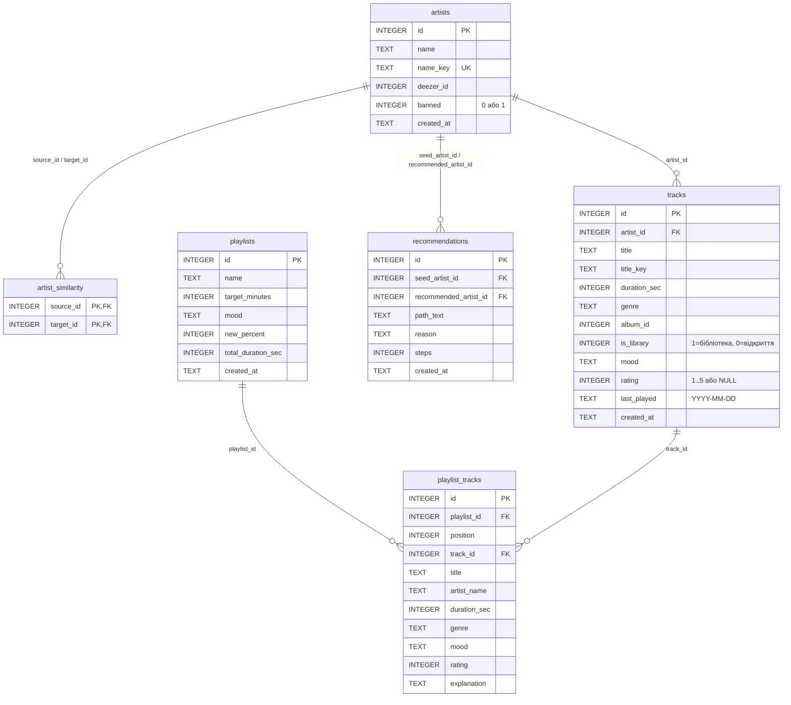

# 🎧 Куратор плейлистів (Playlist Curator)

**Тема:** 02. Куратор плейлистів.
**Варіант:** A. Відкриття нового: граф схожих виконавців з Deezer, частку нових виконавців у плейлисті задає користувач.
**Операційна система для розробки та рецензування:** Windows.

---

## Коротка пропозиція

**Проблема:** Користувачі часто слухають музику під конкретний настрій та тривалість (наприклад, 45-хвилинне тренування), але власні улюблені плейлисти швидко набридають. Шукати нових релевантних виконавців вручну довго і не завжди успішно.
**Рішення:** Програма, яка веде локальну базу вподобань і автоматично генерує плейлисти, що поєднують улюблені треки з новими відкриттями.
**Третя парадигма (на живому шляху):** `Prolog`. Під час генерації плейлиста Python-ядро передає Prolog-у факти про граф схожості виконавців, оцінки та настрій. Prolog розв'язує задачу пошуку ланцюжків схожості (щоб знайти нових виконавців без потрапляння на заборонених) та задачу лінійного сусідства (щоб один виконавець не звучав двічі поспіль).

---

## Міні-ТЗ

### 1. Мета проєкту
Розробити мультипарадигмальний десктопний застосунок для автоматичної генерації смарт-плейлистів на основі заданого настрою, бюджету часу та бажаної частки нових виконавців, використовуючи публічний API Deezer.

### 2. Функціональні вимоги
*   **Управління колекцією:** Користувач може додавати/редагувати інформацію про треки та виконавців у локальній базі (назва, жанр, настрій, оцінка від 1 до 5, статус "заборонений", дата останнього прослуховування).
*   **Інтеграція з Deezer:** Застосунок вміє шукати виконавців, завантажувати їхні популярні треки (`/artist/{id}/top`) та знаходити схожих виконавців (`/artist/{id}/related`) через API Deezer (без авторизації).
*   **Генерація плейлиста:** Користувач задає 3 параметри:
    *   Цільова тривалість (наприклад, 60 хвилин).
    *   Бажаний настрій (наприклад, "енергійний").
    *   Відсоток нових виконавців (наприклад, 30%).
*   **Логіка відбору:** Ядро розраховує "вагу" треків на основі оцінки та давності прослуховування. Prolog-модуль відповідає за включення нових виконавців (ланцюжок схожості <= 3 кроки від улюбленого) та валідацію послідовності (уникнення дублювання виконавців підряд, плавні переходи настрою).
*   **Пояснення (Explainability):** Для кожного треку нового виконавця у фінальному плейлисті виводиться причина його додавання (наприклад: *"Рекомендовано, бо ви слухаєте Blur -> Gorillaz -> [Новий гурт]"*).

### 3. Обмеження
*   **Не є аудіоплеєром:** Програма не відтворює музику і не аналізує аудіофайли. Робота ведеться виключно з метаданими.
*   **Обсяг даних:** Локальна колекція розрахована на 15-30 улюблених виконавців та 150-400 треків.
*   **Технічні обмеження:** 
    *   Предметна область (функціональне ядро) має бути реалізована через чисті функції та незмінні структури даних (`dataclass(frozen=True)`).
    *   Prolog має обов'язково викликатися на "живому шляху" генерування плейлиста (дія користувача -> ООП інтерфейс -> Функціональне ядро -> Prolog -> Результат користувачу).

### 4. Критерії приймання
*   Демонстрація показує двох користувачів з різними профілями оцінок, для яких генеруються кардинально різні плейлисти при однакових вхідних параметрах настрою та часу.
*   Фактична тривалість згенерованого плейлиста максимально наближена до заданої користувачем.
*   У плейлисті відсутні виконавці, яких користувач позначив як "заборонених".
*   Написано мінімум 8 успішних модульних тестів (на чисті функції ядра), включаючи тести на граничні випадки бюджету часу та обробку циклів у графі схожості.
*   Проєкт успішно запускається на "чистій" машині (Windows) лише за інструкціями з README.


### 5. План розширень
*   **E7: Збереження даних у SQLite (`sqlite3`, лише параметризовані запити) — РЕАЛІЗОВАНО:**
    Локальна колекція виконавців, граф схожості, треки (бібліотека та відкриття), знайдені рекомендації з поясненнями та згенеровані плейлисти зберігаються між запусками в SQLite (`data/curator.db`) через модуль [`src/storage/sqlite_store.py`](src/storage/sqlite_store.py) виключно з параметризованими запитами (`?`).

---

## Схема бази даних SQLite (Розширення E7)

Постійне сховище реалізовано в пакеті [`src/storage/`](src/storage) на базі стандартного модуля `sqlite3`. Усі запити (`INSERT`, `SELECT`, `UPDATE`, `DELETE`) використовують **лише параметризовані плейсхолдери `?`** (без інтерполяції рядків) і увімкнені зовнішні ключі (`PRAGMA foreign_keys = ON`).



### Призначення таблиць
*   **`artists`** — зберігає виконавців, їхній `deezer_id` та прапорець блокування `banned` (`0` / `1`), нормалізований ключ `name_key` (`casefold`) гарантує унікальність без дублів по регістру.
*   **`artist_similarity`** — спрямовані ребра графа схожості (`source_id -> target_id`) для Prolog та ядра.
*   **`tracks`** — локальна колекція користувача (`is_library = 1` з оцінкою `rating`, настроєм `mood`, датою `last_played`) і кешовані відкриття (`is_library = 0`).
*   **`recommendations`** — збережені ланцюжки схожості (`Blur -> Gorillaz -> Pulp`) та текстові пояснення (`reason`).
*   **`playlists` та `playlist_tracks`** — історія згенерованих плейлистів і впорядкований склад треків разом із поясненнями рекомендацій (`explanation`).


---


## Встановлення та запуск з чистого клону

Проєкт не містить жорстко прописаних абсолютних шляхів і працює кросплатформно (**Windows**, **Linux**, **macOS**).

### 1. Системні вимоги
*   **Git** (на Windows також встановлюється разом із **Git Bash**; для виконання Bash-команд на Windows можна використовувати Git Bash або WSL, або наведені нижче команди PowerShell).
*   **Python 3.11+** (з модулем `venv`, `sqlite3` входить до стандартної бібліотеки).
*   **SWI-Prolog** (інтерпретатор та бібліотека `libswipl` — обов'язково для логічної парадигми та `pyswip`).
*   **Python-залежності** (перелічені у [`requirements.txt`](requirements.txt)): `pytest>=8.0`, `pyswip>=0.3.3`, `mypy>=1.10`.

### 2. Клонування репозиторію в порожню теку

```bash
git clone <URL_РЕПОЗИТОРІЮ> playlist-curator-clean
cd playlist-curator-clean
# Якщо проєкт лежить у підтеці final_project/, перейдіть у неї:
# cd final_project
```

### 3. Встановлення SWI-Prolog

**Windows (PowerShell):**
```powershell
winget install SWI-Prolog.SWI-Prolog
```
*(Типовий шлях встановлення: `C:\Program Files\swipl\bin`. Перезапустіть термінал або додайте шлях до `PATH`; код у [`src/logic/prolog_engine.py`](src/logic/prolog_engine.py) також автоматично шукає `swipl` у стандартних директоріях Windows/macOS/Linux:)*
```powershell
# Для поточної сесії PowerShell (якщо swipl ще не в PATH):
$env:Path = "C:\Program Files\swipl\bin;$env:Path"
```

**Linux (Ubuntu / Debian):**
```bash
sudo apt update && sudo apt install -y swi-prolog
```

**macOS (Homebrew):**
```bash
brew install swi-prolog
```

### 4. Встановлення Python-залежностей (`pytest`, `pyswip`, `mypy`)

> **Швидкий альтернативний варіант (автоматичне розгортання):**
> У кореневій теці проєкту доступні командні файли без абсолютних шляхів, які самі створюють `.venv` у своїй теці, встановлюють `requirements.txt`, перевіряють `SWI-Prolog`, запускають `mypy`, `pytest` і `src/demo.py`:
> - **Windows (CMD / PowerShell):** `.\setup.bat`
> - **Linux / macOS / Windows (Git Bash або WSL):** `bash setup.sh` (на Windows для Bash-скрипта потрібен Git Bash або WSL).
>
> Нижче наведено повну ручну покрокову інструкцію.

З кореневої директорії проєкту (`final_project`):

**Windows (PowerShell):**
```powershell
python -m venv .venv
# Якщо PowerShell блокує Activate.ps1, дозвольте локальні скрипти:
# Set-ExecutionPolicy -ExecutionPolicy RemoteSigned -Scope CurrentUser
.venv\Scripts\Activate.ps1
pip install -r requirements.txt
```

**Windows (Git Bash):**
```bash
python -m venv .venv
source .venv/Scripts/activate
pip install -r requirements.txt
```

**Linux / macOS:**
```bash
python3 -m venv .venv
source .venv/bin/activate
pip install -r requirements.txt
```

**Перевірка, що Prolog працює разом з Python:**
```bash
swipl --version
python -c "from pyswip import Prolog; print('Prolog OK')"
```

### 5. Перевірка типізації ядра (`mypy`)

Усі функції та структури ядра [`src/core/`](src/core) повністю типізовані:
```bash
python -m mypy src/core
```
Або у строгому режимі:
```bash
python -m mypy --strict src/core
```
Очікуваний результат: `Success: no issues found in 6 source files`.

### 6. Запуск тестів (`pytest`)

```bash
# Тести функціонального ядра:
python -m pytest tests/unit/test_core.py -v

# Усі модульні тести (ядро, ООП-модель, REPL, CLI, Prolog-міст та SQLite E7):
python -m pytest tests/unit -v

# Повний набір тестів (разом з живими інтеграційними тестами SWI-Prolog та Deezer API):
python -m pytest -v
```

---

## Запуск проєкту (Наскрізний шлях)

> **Швидкий запуск скриптом (рекомендовано після `setup.bat` / `setup.sh`):**
> - **Windows (CMD / PowerShell):** `.\run.bat` — інтерактивний REPL; `.\run.bat demo` — демонстрація; `.\run.bat test -v` — тести; або з аргументами CLI (наприклад, `.\run.bat playlists`).
> - **Linux / macOS / Git Bash / WSL:** `bash run.sh` — інтерактивний REPL; `bash run.sh demo` — демонстрація; `bash run.sh test -v` — тести.

### Демонстрація трьох парадигм та SQLite (ООП -> Функціональне ядро -> Prolog -> SQLite E7)
```bash
# Windows / Linux / macOS (у активованому .venv):
python src/demo.py
# На Linux/macOS без .venv: python3 src/demo.py
```

### Інтерактивний режим (REPL — живий шлях + збереження в SQLite)
```bash
python src/main.py
```

Приклад наскрізного сценарію всередині REPL (дані автоматично зберігаються у `data/curator.db` і відновлюються після перезапуску):
```text
curator> add "Kaboom" "Lady Gaga" --seconds 183 --mood energetic --rating 5
curator> discover "Mindless Self Indulgence" --artists 5 --tracks 3
curator> relate Blur Gorillaz
curator> ban "Olivia Rodrigo"
curator> generate --minutes 15 --mood energetic --new-percent 30 --name "Новий Плейлист"
curator> quit
```

Перевірка збережених даних після перезапуску (у новому запуску REPL або через CLI):
```bash
python src/main.py library
python src/main.py library --discoveries
python src/main.py discoveries --artist "Judas" --limit 5
python src/main.py playlists
python src/main.py playlists --id 1
python src/main.py recommendations
python src/main.py generate "Blur" --offline --minutes 15
```

### Одноразова генерація з командного рядка (CLI)
```bash
python src/main.py generate "Mindless Self Indulgence" --minutes 20 --mood energetic --new-percent 30
```